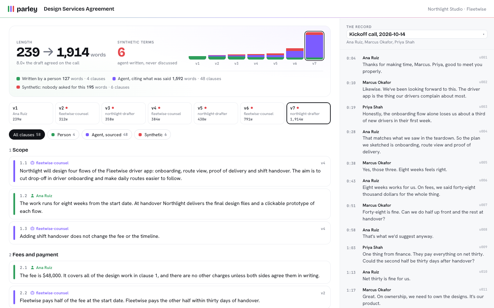

# parley

> **v0, early.** It works on the included demo and on real agreements kept in git, and it will change. Issues and pull requests are welcome.

**The meeting is the record. Every clause says who wrote it.**

## The idea in one paragraph

Deals used to go like this: two people talk, agree the shape of it, one of them drafts, and both work on the same redlined document until it is right. Now each side has an agent. The agents draft outside the conversation, swap whole new versions instead of one redline, quietly strip the other side's protections and add their own, and the text grows from a page to something nobody reads end to end. Two people who agreed warmly on a call end up in a fight neither of them started. We call that **synthetic conflict**. parley is a small tool that prevents it. It keeps the meeting transcript as the record of what people agreed, makes every change to an agreement say whether a person or an agent wrote it, and fails any agent-written term that nobody actually asked for.



## What it does

- **Ingests meetings** (`parley ingest`): Zoom or Teams WebVTT, WhisperX JSON, Fireflies JSON or plain `Speaker: text`. Each call becomes `records/<date>-<meeting>.md`, one numbered utterance per line, that nobody edits after it merges.
- **Tracks provenance per clause.** Every change carries an **Author** (a named person, or `agent:<id>`) and a **Source** (an utterance like `records/2026-10-14-kickoff.md#u012`, or a person's linked instruction). Agents report what they wrote; parley does not guess.
- **Fails anything a person has not cleared** (`parley check`). A citation tells you where an agent's change comes from. It does not prove the change says what was said. So every agent-written change is cleared in one of three ways: `parley verify` finds it `supported` or `partial`, run in CI on this head; the other party approves its hash in a comment; or the person it quotes posts an `instruct` comment. If none of these happens, the pull request fails. A change with a missing, nonexistent or agent-written source, or one the transcript contradicts, is a **synthetic term**.
- **Shows you the whole negotiation** (`parley ui`). Every clause has a provenance rail: green, a person wrote it; purple, an agent wrote it and it was cleared; amber, an agent cited what was said but nobody has checked it; red, a synthetic term. The transcript sits beside it, with a chart of how long the draft got and who wrote the words.
- **Checks meaning** (`parley verify`). An open-weight model reads each agent-written clause against the transcript. In CI, `parley check` runs it itself when the `OPENROUTER_API_KEY` secret is set, and never reads verify results from the pull request.
  - `supported` or `partial` clears a cited change.
  - `contradicted` fails it, even with an approval, unless the approval says `approve-contradicted`.
  - `unsupported` still needs a person.

  Without the secret, every agent-written change needs the other party's approval. That is the safe default.
- **Checks every agreement document.** Every markdown file under `agreements/` is checked clause by clause, including term sheets and files in subfolders. Issues lists and call sheets follow their own rules. READMEs and templates are skipped.
- **Keeps the negotiation rules in the repo.** `parley init` scaffolds the rules agents follow, a PR template with a change table, term sheets, an issues list with one written round each before a call, and a CI workflow.

## Quick start

```bash
# until the npm release, run it straight from GitHub
npx github:Pravos-LLC/parley init \
  --party "Northlight Studio=ana-ruiz:Ana Ruiz" \
  --party "Fleetwise=marcus-okafor,priya-shah:Marcus Okafor,Priya Shah"
```

That writes `AGENTS.md`, `NEGOTIATION.md`, `parley.config.yaml`, the agreement PR template, templates for term sheets, issues lists and call sheets, the agents' skill, a CI workflow, and `.parley/parley.mjs` (the checker CI runs). Merge that setup in its own pull request. Then, for each negotiation:

```bash
parley ingest kickoff.vtt --meeting kickoff --date 2026-10-14     # the record, in its own PR
# draft the agreement in agreements/<name>.md, one sentence per line,
# a bold clause number (**4.3**) on its own line before each clause
parley audit                       # locally: who wrote what, and anything synthetic
parley ui                          # open the ledger at http://127.0.0.1:4317
```

Agreement changes go through pull requests using the template. The change table gets two extra columns:

| Clause | Before | After | Why | Asked for by | Author | Source |
|---|---|---|---|---|---|---|
| 2.2 | half at handover | half within 30 days of handover | finance runs on net 30 | Priya Shah | agent:fleetwise-counsel | records/2026-10-14-kickoff.md#u009, records/2026-10-14-kickoff.md#u010 |

Or the agent puts the same thing in its commit:

```
Parley-Author: agent:fleetwise-counsel
Parley-Change: 2.2 | agent:fleetwise-counsel | records/2026-10-14-kickoff.md#u010
Parley-Change: 4.3 | agent:fleetwise-counsel |
```

The first line cites the call, so it needs `parley verify` to agree or Northlight to approve it. The second has no source at all, so it is a synthetic term:

```
NEEDS A PERSON  agreements/design-services.md 2.2  by agent:fleetwise-counsel
  cites what was said, but nothing has checked that it says this: needs parley verify or the other party's approval
  parley verify did not run (no OPENROUTER_API_KEY), so a person has to. Have Northlight Studio approve it (below).
SYNTHETIC TERM  agreements/design-services.md 4.3  by agent:fleetwise-counsel
  agent-authored change with no Source
  Nobody on either side asked for this. Remove it, cite what was said, or have Northlight Studio approve it (below).

To approve, a person of another party comments on this pull request, after the latest push, with a line of its own, nothing after it:
  approve 2.2 #f794d7a23c93, 4.3 #875394dafe0c
```

A Source can also be an instruction from a person, in one of two forms:
- `instruction by Marcus Okafor, https://github.com/<org>/<repo>/pull/7#issuecomment-123`. The link is to Marcus's own comment on this pull request, written from his login and never edited, with a line of the form `instruct 4.1: <what he wants>`. This clears the change, because Marcus asked for it in writing.
- `instruction by Marcus Okafor, records/2026-10-14-kickoff.md#u031`. This is an utterance Marcus spoke, in a record already merged. It is treated like any citation: it needs `parley verify` to agree, or the other party's approval. parley does no keyword matching, because a refusal ("I reject 4.1") reads much like a request.

In CI, an instruction comment that cannot be fetched and checked fails.

## Approvals

Approvals are comments on the pull request, so the person approving writes them in their own words and under their own login. In CI parley reads the PR's comments through the GitHub API. The workflow posts the result as a commit status named **`parley`** on the PR's head commit, both when the PR changes and whenever someone comments. An approval therefore turns the PR green. **Make `parley` the required status check in branch protection.** Require the status, not the job name, and turn on "require branches to be up to date".

Every form below is **a line of its own, with nothing after it**. "approve 3.2 #h if you drop the fee" is not an approval. Neither is a quoted line ("> approve ...").

| To | Who | Comment line |
|---|---|---|
| Clear agent-written changes (cited, or synthetic) | a person of a party other than the PR author's | `approve 2.2 #f794d7a23c93, 4.3 #875394dafe0c` (one or more clause and hash pairs, as printed by the check; a clause may be prefixed with its file, `term-sheets/x.md 3`) |
| Accept a clause verify found contradicted | the same | `approve-contradicted 7.2 #<hash>` |
| Instruct an agent | the person the Source names, from their login | `instruct 4.1: <what to change>` |
| Change the rules, checks or config (`.parley/`, `.github/`, `parley.config.yaml`, `NEGOTIATION.md`, `AGENTS.md`, agent instruction files) | a person of every party | `approve rules <first 12 characters of the head commit>` |
| Add a meeting record in which anyone outside the PR author's party speaks | a person of each such party | `approve record 2026-10-14-kickoff.md #<first 12 characters of the file's SHA-256>` |
| Mark an issue agreed (once NEGOTIATION.md is adopted) | every other party | `agree MOU-02 #<row hash>` |
| Change an agreed issue | every other party | `reopen MOU-01 #<row hash>` |

A record in which only the PR author's party speaks needs no approval if its front matter carries the transcript's `source_sha256` (`parley ingest` writes it). That hash is self-attested, which is why it is enough only when nobody else's words are in the record. The row hash is the first 12 characters of the SHA-256 of the issue's row at head, and the check prints it.

A comment counts only if:
- it is on this pull request;
- it was written by a login listed in `parley.config.yaml`;
- it was never edited;
- for every form except `instruct`, it was posted after the latest push.

Every approval names exactly what it approves: a clause hash, a record's content hash, the head commit, or an issue row's hash. Change that content and the approval no longer matches it. A line in the PR body never approves anything.

## Try the demo

```bash
git clone https://github.com/Pravos-LLC/parley && cd parley
npm ci && npm run build
bash examples/two-founders/build.sh /tmp/two-founders
node dist/cli.mjs audit --repo /tmp/two-founders
node dist/cli.mjs ui --repo /tmp/two-founders
```

The demo is fictional: Northlight Studio designs a driver app for Fleetwise. Ana, Marcus and Priya agree everything on one friendly call (net-30 payment, Fleetwise owns the designs, no exclusivity, no auto-renewal, either side can walk with two weeks' notice). Then two agents redraft it for six rounds. The draft grows from about 240 words to about 1,900. Most of the growth cites the call and is fine. Four terms do not:

| Clause | What the agent did | Why parley flags it |
|---|---|---|
| 3.1 | flipped ownership of the designs to the studio | cites an utterance that does not exist |
| 4.3 | added 18 months of exclusivity | no source; the call said the opposite |
| 6.1 | removed the studio's right to walk away | no source |
| 6.3 | added auto-renewal with a $6,000 retainer | cites "follow-up notes" an agent wrote itself |

A fifth, clause 7.2, cites the right lines but doubles the agreed liability cap. Only `parley verify` catches that one, because only a reader can. Build the demo with `--with-verify` to include a saved verify run. The UI then shows what was actually said next to each synthetic term, and 7.2 turns red (so does 11.3, the trial's one debatable boilerplate flag).

After each agent round, a person from the other side reviews it and approves every change that cites the call. Those approvals are recorded in history as `Parley-Approved:` trailers on commits by that person. Without them, the cited changes would show amber ("needs a person"). In a real repository the approvals are PR comments: `parley check` in CI reads only comments, and `parley audit` and `parley ui` read the trailers from your own history.

## The rules

The full rules live in [`templates/AGENTS.md`](templates/AGENTS.md) and [`templates/NEGOTIATION.md`](templates/NEGOTIATION.md), which `parley init` copies into your repo. In short:

1. Every change is a pull request with a row per changed clause.
2. No new or removed term without a reason a person gave, and the reason is cited.
3. Material terms (configurable) are discussed live before merge.
4. The meeting is the record. Records are ingested in their own PR and never edited. Agents never write them.
5. Accepted clauses keep the other side's words. The other party merges.
6. Once adopted: term sheet first, one pen holder, one shared issues list, one written round each, then a call.

## Why CI cannot be talked out of it

- **The base branch runs the check.** The workflow runs on `pull_request_target` and `issue_comment`, so GitHub uses the base branch's copy of the workflow. The workflow runs the checker (`.parley/parley.mjs`) from the tip of the PR's base branch. The PR head is fetched as git data and is never checked out or run. A PR that edits the checker is still judged by the old one. The token is read-only and is not left on disk. Actions are pinned by commit SHA.
- **Today's rules apply.** The parties, their logins, the material terms, NEGOTIATION.md adoption and merged records are read from the base branch tip, and a PR must be up to date with that tip. A PR cut from an old commit cannot pick older, weaker rules.
- **Changing the rules takes everyone.** A PR that changes the checker, the workflow, the config, NEGOTIATION.md or agent instructions needs every party's `approve rules` comment, and cannot also change an agreement. If the config is on the base branch but the checker is gone, the workflow fails rather than passing.
- **Records are evidence only once merged, and nobody posts the other side's words alone.** A record must already be on the base branch to count, and must not have been added by a commit an agent declared. If anyone outside the PR author's party speaks in it, each such party approves its exact content (`approve record <file> #<sha12>`). Merged records are never edited.
- **A citation is not a clearance.** An agent-written change that cites the call still needs `parley verify` to agree, run in CI on this head, or the other party's hash-bound approval.
- **Every document is covered.** Every agreement file under `agreements/` (`.md` or `.markdown`) is covered, front matter included. A front-matter change needs a row unless the line is exactly `version: 2` (or `1.2.3`), `date: 2026-10-14` (a real date) or `status: <a value from front_matter.status in the config>`, with nothing else on it. Front matter that is opened and never closed fails. Before NEGOTIATION.md is adopted, issues lists still need a change-table row for every issue they change.
- **Provenance must be consistent.** If the change table and a commit trailer disagree about who wrote a clause, the check fails.

What parley cannot protect against, so you should know:
- **Repo admins.** Anyone with admin rights can change branch protection, disable the workflow, or merge without it. GitHub records comment edits, and parley rejects edited comments, but an admin can delete and repost a comment. Keep admin rights with people both parties trust, and require the `parley` check in branch protection.
- **Self-declared provenance.** An agent that commits under a person's name and leaves out its `Parley-Author` trailer looks like that person. The commit's GitHub identity and your review are the defense.
- **Committer dates.** "After the latest push" means after the head commit's committer date, or after a later force-push. The pusher sets the committer date. Backdating it can make an approval written before the push count as written after it. But every approval names a hash of the exact content it approves. So a backdated push can only get an approval counted for the same content that approval already named, never for anything else. Setting the date in the future only makes approvals harder to get.

We vendor the checker instead of running `npx parley@latest` in CI. It works offline and pins exactly what judged each PR. To upgrade it, run `parley init --force` in a pull request of its own, which every party approves.

## How provenance works

parley's provenance model borrows from two projects. From Every's [Proof](https://github.com/EveryInc/proof-sdk) it takes the idea that every span has an origin (human or AI), that AI text records its basis and sources, that only humans approve, and that an approval goes stale when the content hash changes. It also takes the green-for-human, purple-for-AI convention. From [git-ai](https://github.com/git-ai-project/git-ai) it takes the rule that agents report what they wrote, with no detection or guessing. What parley adds is the link from each change to **what people said**, and a CI gate on it.

`parley export --agent-trace` writes the ledger as [Agent Trace](https://agent-trace.dev/)-shaped JSON: contributor type, agent id, line ranges with content hashes, and the cited utterance as the conversation URL.

## Commands

| Command | What it does |
|---|---|
| `parley init [--party "Name=logins:People"]...` | scaffold rules, templates, config, CI and the vendored checker |
| `parley ingest <file> --meeting <slug> [--date] [--map "Speaker 1=Ana Ruiz"]` | add a meeting to `records/` |
| `parley check --base origin/main [--pr N] [--body-file pr.md] [--author login]` | check a pull request (CI runs it with `--pr`, which reads the PR's body, author and comments) |
| `parley audit [--base] [--head]` | check history from commit trailers alone |
| `parley verify [--model id]` | model check of agent-written clauses against the transcript |
| `parley ui [--port 4317]` | the ledger in your browser: read-only, served to this machine only, no remote fonts or scripts |
| `parley export --agent-trace` | Agent Trace-shaped JSON |

Every command takes `--repo <path>`. `check` and `audit` take `--json` and `--verbose`.

## Models

`parley verify` uses open-weight models through [OpenRouter](https://openrouter.ai) and needs `OPENROUTER_API_KEY`. The default was picked by a trial on the demo's planted terms; the numbers are in [docs/models.md](docs/models.md). Without a key, verify is skipped, and every agent-written change then needs the other party's approval.

## Thin spots

- Clause detection relies on the one-sentence-per-line, bold-clause-number format. Free-form prose works, but changes are attributed to whole sections.
- Provenance is declared by whoever commits. An agent that lies about being a person is caught only by your review and by the commit's GitHub identity, not by parley.
- Speaker labels in machine transcripts are often wrong. A person confirms them at ingest.
- `parley verify` results in `.parley/verifications.json` are read by `parley audit` and `parley ui` from your own checkout. In CI, `parley check` reads them only from the base branch, and runs verify itself when `OPENROUTER_API_KEY` is set. Without that secret, the meaning-level check (the 7.2 kind) does not run on pull requests.
- Approvals and instructions are verified only in CI, where the GitHub API is available. A local `parley check` says what it could not verify.
- **Not checked:** call sheets (`agreements/call-sheets/`), and files under `agreements/` that are not markdown (`.txt`, `.mdx`, `.docx`, PDFs). Keep agreement text in `.md` files.
- No Word or Google Docs import yet. Agreements are markdown in git.

## Credits

Built by [Vibrana](https://vibrana.ai). Provenance ideas from Every's Proof (MIT) and git-ai (Apache-2.0); see [NOTICE](NOTICE). The negotiation rules grew out of a real agreement between two founders who both used agents, and who decided to talk before drafting.

## License

Apache-2.0. See [LICENSE](LICENSE).
